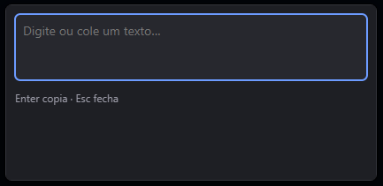

# Shortcut Translator (Tradutor por atalho)

**English** · [Português](README.md)

A system-tray app for **Windows 10/11** (Tauri v2 + React/TypeScript) that translates quickly
between English and Brazilian Portuguese. It is built for people learning English who want to
translate without leaving what they are doing. The app's interface is in Portuguese. The
repository is named `lang`.



Press **`Ctrl+Alt+T`** in any app: a floating box opens near the cursor. If text was selected, it
is filled in and translated right away. English becomes Portuguese; any other language becomes
English. **Esc** closes it; **Enter** copies the translation and closes.

## Features

- **Translation** through DeepL, with automatic source-language detection.
- **Selection capture:** text selected in another app shows up in the box automatically.
- **Explain** (optional): Claude explains grammar and vocabulary and gives usage examples, in
  Portuguese, in real time.
- **History:** keeps what you confirm (Enter or Explain), with search, favorites, flashcard-style
  review of favorites and CSV export.
- **Settings:** shortcut, API keys, theme, variants (American/British English, Brazilian/European
  Portuguese), the Explain model and start with Windows.

## Installation

1. Download the installer `Tradutor_<version>_x64-setup.exe` from the repository's **Releases**
   page.
2. Run it. The installation is **per user**: it does not ask for administrator rights.
3. Windows SmartScreen will warn about an **"unknown publisher"**, because the installer is not
   code-signed (code-signing certificates are paid). Click **More info → Run anyway**.
4. On first run the **Settings** window opens by itself. Paste your **DeepL** key (the free plan
   works; free keys end in `:fx`) and click **Test key** (the button label in the app is in
   Portuguese).
5. Optional: also paste your **Anthropic** key to use the **Explain** button.

Requirements: Windows 10 or 11 with WebView2 (included in Windows 11 and most Windows 10
installs).

**Updates:** the app never checks for new versions on its own. In **Settings → About and updates**,
click **Check for updates**; if there is a new version, **Install and restart** downloads the
installer from GitHub Releases, verifies its signature and installs over the current one.

## Usage

| Action | How |
|---|---|
| Open the translator | `Ctrl+Alt+T` (configurable), or click the tray icon |
| Translate text from another app | Select the text and press the shortcut |
| Copy the translation | **Enter** (also saves it to the history) |
| Close | **Esc**, or click outside |
| Resize | Drag the edges or corners of the box (the cursor changes over them). The size is remembered, and the box grows by itself to fit the translation and the explanation |
| Move | Double-click an empty area of the box and hold the second click, then drag |
| Keep on screen | Pin button in the corner of the text field: while pinned, the popup does not disappear when you click another app and **Enter** copies without closing. **Esc** closes and unpins |
| Understand the translation | **Explain** button (needs the Anthropic key) |
| History, settings, quit | Tray icon menu |

## Privacy and security

- API keys live **only in Rust**, in the Windows Credential Manager. The UI cannot read them and
  they are never logged.
- The text you translate is sent to **DeepL**. The **Explain** text is sent to **Anthropic**
  **only when you click** the button. There is an option to translate captured selections only
  after you press Enter.
- The **history** stays on this computer only, at `%APPDATA%\com.yansa.lang-app\history.db`, **in
  plain text**, and may include text selected in other apps. You can turn recording off, delete
  items or everything, and export from the history window itself.
- To capture the selection, the app simulates `Ctrl+C` in the focused app and restores the
  clipboard afterwards. That text may briefly appear in the Windows clipboard history (`Win+V`).
- Capture is **never** done in terminals, SSH clients, remote consoles or virtual machines, where
  `Ctrl+C` would interrupt a process. In editors with an embedded terminal (VS Code, Cursor,
  JetBrains) it is off by default and can be enabled in Settings. In those apps the popup opens
  empty.
- Apps running as administrator do not allow capture (a Windows limitation).

## Troubleshooting

- **The shortcut does nothing:** another app may be using the combination. Change it in
  **Settings → Global shortcut**. The tray icon warns you when the shortcut could not be
  registered.
- **The popup opens empty with text selected:** the focused app may be a blocked terminal or
  editor, or it may be running as administrator. Type or paste the text instead.
- **The app does not start:** a message box names the file with the reason
  (`%LOCALAPPDATA%\com.yansa.lang-app\startup-error.log`). Regular logs are in
  `%LOCALAPPDATA%\com.yansa.lang-app\logs`.

## Uninstalling

Use **Windows Settings → Apps**. The uninstaller offers to delete the app's data. **API keys are
not removed**: delete them first in **Settings → Remove key**, or afterwards in the **Windows
Credential Manager** (generic credentials containing `com.yansa.lang-app`). History and settings
live in `%APPDATA%\com.yansa.lang-app`.

## Development

The project runs on Windows. Requirements: Node.js 22+ and Rust (MSVC toolchain).

```powershell
git clone https://github.com/yansntss/lang.git
cd lang
npm install
npm run tauri dev
```

```powershell
npm test                                   # front-end tests
npm run build                              # tsc + vite
npm run check:version                      # same version in package.json, Cargo.toml and tauri.conf.json
cd src-tauri
cargo test                                 # Rust tests
cargo test -- --ignored                    # tests that use the real clipboard and keychain
cargo clippy --all-targets -- -D warnings
cargo fmt --check
cargo audit                                # known vulnerabilities in dependencies
```

To build the installer (NSIS, in `src-tauri/target/release/bundle/nsis/`) and test it on your
machine. This command does not need the updater signing key, because it does not produce the
update files:

```powershell
npm run build:local
```

To publish a version (signing key, GitHub Actions, repository protections), see
[`docs/RELEASING.md`](docs/RELEASING.md) (in Portuguese). The plan, decisions and status of each
phase are in [`docs/PLAN.md`](docs/PLAN.md) (also in Portuguese).

## Issues and suggestions

Found a bug or have an idea? Open an [issue](https://github.com/yansntss/lang/issues). For now
the project does not accept pull requests.

## License

[MIT](LICENSE).
