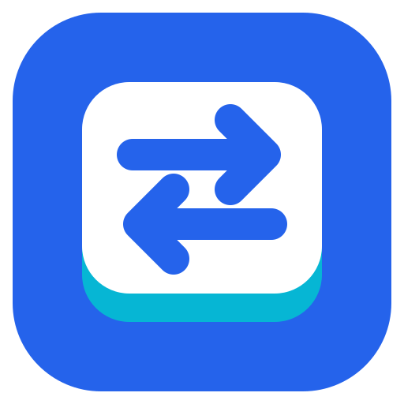
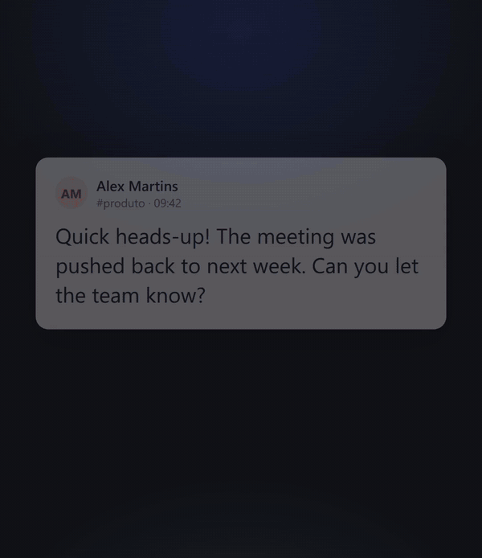

<p align="center"></p>

# Lang — tradutor por atalho

[English](README.en.md) · **Português**

App de bandeja para **Windows 10/11** (Tauri v2 + React/TypeScript) que traduz rápido entre inglês
e português, feito para quem está aprendendo inglês e quer traduzir sem sair do que está fazendo.
A interface e esta documentação estão em português. O repositório se chama `lang`.

<p align="center">
  <a href="https://github.com/yansntss/lang/releases/latest"></a>
</p>

<p align="center"></p>

Aperte **`Ctrl+Alt+T`** em qualquer app: abre uma caixa flutuante perto do cursor. Se havia texto
selecionado, ele já vem preenchido e é traduzido na hora. Inglês vira português; qualquer outro
idioma vira inglês. **Esc** fecha; **Enter** copia a tradução e fecha.

Texto que não dá para selecionar (legenda de jogo, imagem, vídeo)? Aperte **`Ctrl+Alt+Y`**, a tela
escurece, e você arrasta um retângulo sobre o texto: o app lê o trecho com o OCR do próprio
Windows e traduz.

## O que faz

- **Tradução** pelo DeepL, com detecção automática do idioma de origem.
- **Captura da seleção:** o texto selecionado em outro app já aparece no campo.
- **Ler da tela (OCR):** arraste sobre qualquer trecho da tela para traduzir o que estiver escrito
  nele. Usa o OCR nativo do Windows, offline e sem chave.
- **Legenda ao vivo** (opcional): depois de ler um trecho, o app relê a mesma área a cada intervalo
  e traduz cada fala nova, bom para legendas de jogos e vídeos.
- **Explicar** (opcional): o Claude explica gramática, vocabulário e dá exemplos de uso, em
  português, em tempo real.
- **Histórico:** guarda o que você confirma (Enter ou Explicar), com busca, favoritos, revisão dos
  favoritos em cartões e exportação para CSV.
- **Configurações:** os dois atalhos, chaves de API, tema, variantes (inglês americano/britânico,
  português do Brasil/de Portugal), modelo do Explicar, legenda ao vivo (e o
  intervalo) e início com o Windows.

## Instalação

1. Baixe o instalador `Lang_<versão>_x64-setup.exe` na
   [página da versão mais recente](https://github.com/yansntss/lang/releases/latest).
2. Execute-o. A instalação é **por usuário**: não pede administrador.
3. O Windows SmartScreen vai avisar sobre um **"editor desconhecido"**, porque o instalador não é
   assinado (assinatura de código é paga). Clique em **Mais informações → Executar assim mesmo**.
4. Na primeira execução a janela **Configurações** abre sozinha. Cole a chave do **DeepL** (o plano
   gratuito serve; as chaves gratuitas terminam em `:fx`) e clique em **Testar chave**.
5. Opcional: cole também a chave da **Anthropic** para usar o botão **Explicar**.

Requisitos: Windows 10 ou 11 com WebView2 (já vem no Windows 11 e na maioria dos Windows 10).

**Atualizações:** o app nunca procura versões novas sozinho. Em **Configurações → Sobre e
atualizações**, clique em **Verificar atualizações**; se houver uma versão nova, **Instalar e
reiniciar** baixa o instalador do GitHub Releases, confere a assinatura e instala por cima.

## Como usar

| Ação | Como |
|---|---|
| Abrir o tradutor | `Ctrl+Alt+T` (configurável), ou clique no ícone da bandeja |
| Traduzir um trecho de outro app | Selecione o texto e aperte o atalho |
| Traduzir texto da tela (jogo, imagem, vídeo) | `Ctrl+Alt+Y` (configurável) e arraste um retângulo sobre o texto. **Esc** cancela |
| Acompanhar uma legenda | Depois de ler um trecho, clique em **Legenda ao vivo** (ative antes em **Configurações**). **Parar legenda** encerra |
| Copiar a tradução | **Enter** (também grava no histórico) |
| Fechar | **Esc**, ou clique fora |
| Redimensionar | Arraste as bordas ou os cantos da caixa (o cursor muda ao passar por eles). O tamanho é lembrado, e a caixa cresce sozinha para caber a tradução e a explicação |
| Mover | Clique duas vezes numa área vazia da caixa e segure no segundo clique, depois arraste |
| Deixar na tela | Botão de alfinete no canto do campo: fixado, o popup não some ao clicar em outro app e o **Enter** copia sem fechar. **Esc** fecha e solta |
| Entender a tradução | Botão **Explicar** (precisa da chave da Anthropic) |
| Histórico, configurações, sair | Menu do ícone da bandeja |


## Privacidade e segurança

- As chaves de API ficam **só no Rust**, no Gerenciador de Credenciais do Windows. A interface não
  consegue lê-las e elas nunca vão para o log.
- O texto que você traduz é enviado ao **DeepL**. O texto do **Explicar** é enviado à **Anthropic**
  **somente quando você clica** no botão. Há uma opção para a seleção capturada só ser traduzida
  depois do Enter.
- O **histórico** fica só neste computador, em `%APPDATA%\com.yansa.lang-app\history.db`, **em texto
  simples**, e pode incluir textos selecionados em outros apps. Dá para desligar a gravação,
  apagar itens ou tudo, e exportar na própria janela do histórico.
- Para capturar a seleção, o app simula `Ctrl+C` no app em foco e devolve o clipboard ao que era
  antes. Esse texto pode aparecer, por um instante, no histórico do clipboard do Windows (`Win+V`).
- A captura **nunca** é feita em terminais, clientes SSH, consoles remotos ou máquinas virtuais,
  onde `Ctrl+C` interromperia um processo. Em editores com terminal embutido (VS Code, Cursor,
  JetBrains) ela fica desligada por padrão e pode ser liberada nas Configurações. Nesses apps o
  popup abre vazio.
- Apps rodando como administrador não permitem a captura (limitação do Windows).
- A leitura da tela (OCR) acontece **no próprio computador**: só o texto reconhecido vai ao DeepL,
  nunca a imagem. Na legenda ao vivo, cada fala nova gasta cota do DeepL.

## Problemas comuns

- **O atalho não faz nada:** outro app pode estar usando a combinação. Troque em
  **Configurações → Atalho global**. O ícone da bandeja avisa quando o atalho não pôde ser
  registrado.
- **O popup abre vazio com texto selecionado:** o app em foco pode ser um terminal ou editor
  bloqueado, ou estar rodando como administrador. Digite ou cole o texto.
- **O OCR diz que não há idioma de reconhecimento:** adicione o **Inglês (Estados Unidos)** em
  **Configurações do Windows → Hora e idioma → Idioma e região**.
- **O app não abre:** uma caixa de mensagem informa o arquivo com o motivo
  (`%LOCALAPPDATA%\com.yansa.lang-app\startup-error.log`). Os logs normais ficam em
  `%LOCALAPPDATA%\com.yansa.lang-app\logs`.

## Desinstalar

Use **Configurações do Windows → Aplicativos**. O desinstalador oferece apagar os dados do app.
As **chaves de API não são removidas**: apague-as antes, em **Configurações → Remover chave**, ou
depois, no **Gerenciador de Credenciais do Windows** (credenciais genéricas que contêm
`com.yansa.lang-app`). O histórico e as configurações ficam em `%APPDATA%\com.yansa.lang-app`.

## Desenvolvimento

O projeto roda no Windows. Requisitos: Node.js 22+ e Rust (toolchain MSVC).

```powershell
git clone https://github.com/yansntss/lang.git
cd lang
npm install
npm run tauri dev
```

```powershell
npm test                                   # testes do front
npm run build                              # tsc + vite
npm run check:version                      # versão igual em package.json, Cargo.toml e tauri.conf.json
cd src-tauri
cargo test                                 # testes de Rust
cargo test -- --ignored                    # testes que usam o clipboard e o keychain reais
cargo clippy --all-targets -- -D warnings
cargo fmt --check
cargo audit                                # vulnerabilidades conhecidas nas dependências
```

Gerar o instalador (NSIS, em `src-tauri/target/release/bundle/nsis/`) para testar na sua máquina.
Este comando não precisa da chave de assinatura do atualizador, porque não gera os arquivos de
atualização:

```powershell
npm run build:local
```

Para publicar uma versão (chave de assinatura, GitHub Actions, proteções do repositório), veja
[`docs/RELEASING.md`](docs/RELEASING.md). O plano, as decisões e o estado de cada fase estão em
[`docs/PLAN.md`](docs/PLAN.md).

## Problemas e sugestões

Encontrou um bug ou tem uma ideia? Abra uma [issue](https://github.com/yansntss/lang/issues).
Por enquanto o projeto não aceita pull requests.

## Licença

[MIT](LICENSE).
